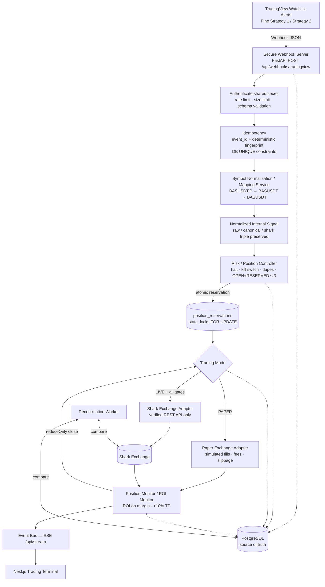
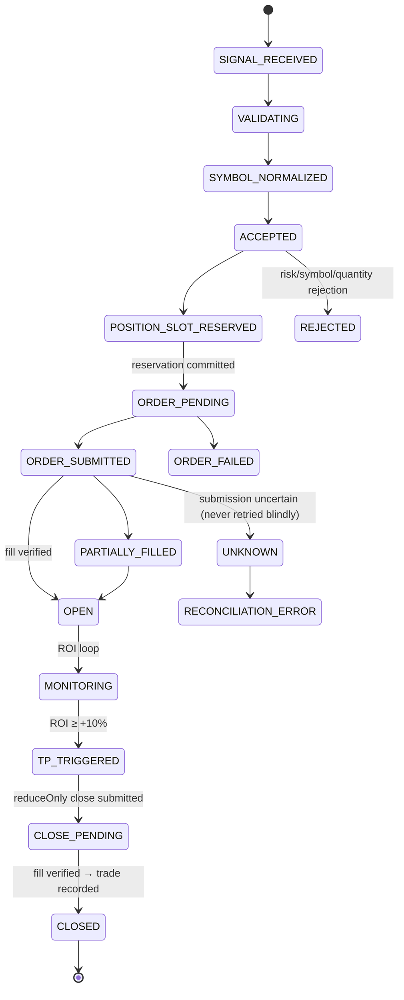

# Architecture

## System overview

## Layering (clean architecture)

```mermaid
flowchart LR
    subgraph api [API Layer]
        WH[webhooks.py]
        RT[routes.py]
    end
    subgraph services [Service Layer]
        PIPE[pipeline.py]
        RISK[risk.py]
        RES[reservation.py]
        SYM[symbols.py]
        EXEC[execution.py]
        POS[position_manager.py]
        ROI[roi_monitor.py]
        RECON[reconciliation.py]
        REPLAY[replay.py]
    end
    subgraph exchanges [Exchange Layer]
        BASE[base.py ExchangeAdapter Protocol]
        PAPER[paper.py]
        SHARK[shark.py]
        MD[market_data.py]
    end
    subgraph core [Core]
        CFG[config.py]
        LOG[logging.py]
        ERR[errors.py]
        SEC[security.py]
        EV[events.py]
    end
    api --> services
    services --> exchanges
    services --> core
    exchanges --> core
```

**Rule:** the trading core only speaks `ExchangeAdapter`. Shark-specific request/response
shapes live exclusively in `exchanges/shark.py`.

## Position state machine

Every transition is persisted in `position_events` → the complete chronological
timeline that answers "why was this trade created / closed?".

## Concurrency model

* Async I/O throughout (FastAPI + async SQLAlchemy + httpx). No uncontrolled threads.
* Workers (`workers/monitor.py`) are asyncio tasks with proper lifecycle (start/stop with the app).
* Position-slot critical section:
  1. per-process asyncio lock (per event loop) → in-process serialization
  2. `SELECT … FOR UPDATE` on `state_locks` row (Postgres) → cross-process serialization
  3. re-count OPEN+RESERVED under the lock
  4. INSERT reservation + RESERVED position + **COMMIT inside the lock**
  5. UNIQUE constraint on active reservation `canonical_symbol` as the final race-proof guard

## Storage (PostgreSQL is the source of truth)

Tables: `settings`, `webhook_events`, `signals`, `orders`, `fills`, `positions`,
`position_events`, `trades`, `strategies`, `symbols`, `symbol_mappings`,
`position_reservations`, `risk_events`, `system_events`, `audit_logs`,
`paper_balances`, `market_snapshots`, `reconciliation_events`, `state_locks`.

Created exclusively via **Alembic migrations** (`backend/alembic/versions/`) —
no runtime DDL.

Restart recovery: on boot the app reloads open positions, active reservations and
pending/unknown orders from the database and continues monitoring. The application
never assumes "restart = no positions".

## Real-time updates

`EventBus` (in-process pub/sub) → **SSE** `GET /api/stream` → Next.js client with
automatic polling fallback. Topics: `signal.updated`, `position.closed`,
`positions.changed`, `risk.changed`, `mode.changed`, `webhook.received`.

## Observability

* Structured JSON logs (`logs/app.log`, `logs/trading.log`, `logs/error.log`, `logs/audit.log`)
* Trading event codes: `WEBHOOK_RECEIVED`, `SYMBOL_NORMALIZED`, `SIGNAL_VALIDATED`,
  `POSITION_SLOT_RESERVED`, `ORDER_SUBMITTED`, `ORDER_FILLED`, `POSITION_OPENED`,
  `ROI_UPDATED`, `TP_TRIGGERED`, `CLOSE_SUBMITTED`, `POSITION_CLOSED`,
  `DUPLICATE_DETECTED`, `MAX_POSITION_REACHED`, `SHARK_SYMBOL_NOT_FOUND`,
  `RECONCILIATION_ERROR`, `SYSTEM_ERROR`, …
* Every log row carries `correlation_id`, `event_id`, symbol triple, `mode` where relevant.
* Secrets are redacted by the logging scrubber and never persisted in payloads.
